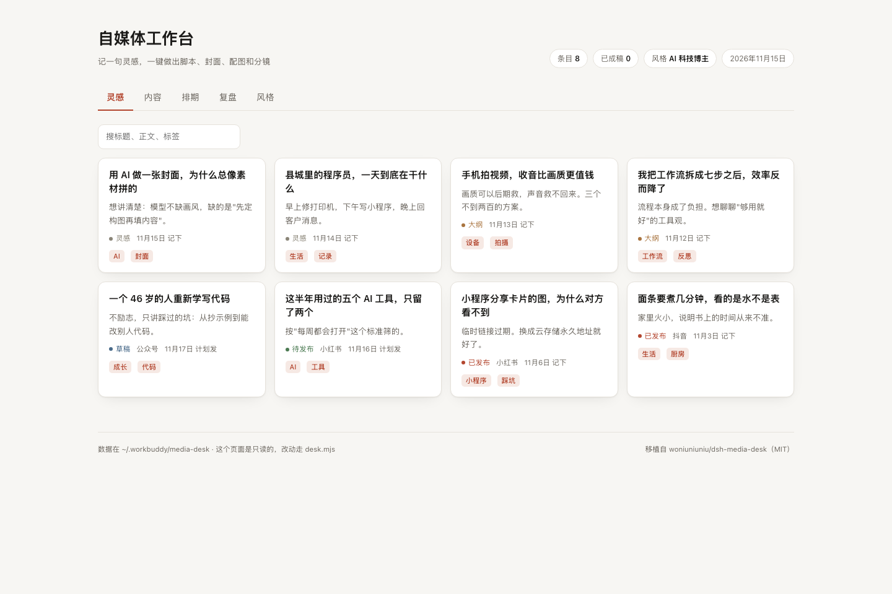

# 安装说明

一页搞定。全程三条命令，不需要改配置文件。

这个仓库同一个包提供两种形态，**选一种装就行**：

| | 得到什么 | 跳到 |
|---|---|---|
| **专家包** | 左侧「专家」里一张卡，点进去直接聊 | 本文 §1 |
| **技能** | 技能列表里的 `media-desk`，任意会话里说「记个灵感」就命中 | 本文附录 |

## 0 · 前置条件

| 需要 | 检查命令 | 说明 |
|---|---|---|
| WorkBuddy | 打开就能看到左侧「专家」 | 桌面版，Windows / macOS 都行 |
| Node.js 20 以上 | `node -v` | 只用来跑本地脚本，不联网 |

`node -v` 报「command not found」就先装 Node：macOS `brew install node`，Windows 去 [nodejs.org](https://nodejs.org) 下 LTS 版。

## 1 · 放到专家目录

**macOS / Linux**

```bash
git clone https://github.com/phs-bitqun/workbuddy-media-desk.git
mkdir -p ~/.workbuddy/plugins/marketplaces/my-experts/plugins
cp -R workbuddy-media-desk ~/.workbuddy/plugins/marketplaces/my-experts/plugins/
```

**Windows（PowerShell）**

```powershell
git clone https://github.com/phs-bitqun/workbuddy-media-desk.git
New-Item -ItemType Directory -Force "$env:USERPROFILE\.workbuddy\plugins\marketplaces\my-experts\plugins" | Out-Null
Copy-Item -Recurse "workbuddy-media-desk" "$env:USERPROFILE\.workbuddy\plugins\marketplaces\my-experts\plugins\"
```

不想用 git 也行：点仓库右上角 **Code → Download ZIP**，解压后把里面那层 `workbuddy-media-desk` 文件夹拷进上面那个 `plugins` 目录。

## 2 · 重启 WorkBuddy

关掉再打开。左侧点「**专家**」，应该能看到一张叫「**自媒体工作台**」的卡片，头像是位戴眼镜的编辑，拿着张空白版式的封面稿。

点进去，它会先跟你打招呼：

> 记个灵感：用 AI 做封面总像素材拼的

到这里就算装好了。

### 没看到卡片？

先跑第 3 步验证包本身没问题。包是好的，就是界面没刷出来，对着 WorkBuddy 说一句：

> 注册 `my-experts` 下的 `workbuddy-media-desk`

它会跑注册脚本把它挂上市场，再重启一次。

## 3 · 不开 WorkBuddy 也能验证

**macOS / Linux**

```bash
node "$HOME/.workbuddy/plugins/marketplaces/my-experts/plugins/workbuddy-media-desk/skills/media-desk/scripts/desk.mjs" doctor
```

**Windows**

```powershell
node "$env:USERPROFILE\.workbuddy\plugins\marketplaces\my-experts\plugins\workbuddy-media-desk\skills\media-desk\scripts\desk.mjs" doctor
```

正常会打印：

```
数据目录：/Users/你/.workbuddy/media-desk
状态文件：…/state.json  不存在
内置风格预设 15 个
```

`不存在` 是正常的——第一次还没建库。接下来在工作台里说「开始用」或者直接记一条灵感，它会自动初始化。

## 4 · 打开看板

五个页面：**灵感 · 内容 · 排期 · 复盘 · 风格**。



看板是**只读**的，用浏览器打开 `~/.workbuddy/media-desk/desk.html` 就能看。改数据都在对话里说，或者走命令行——不要手改 `state.json`。

## 5 · 数据存在哪

`~/.workbuddy/media-desk/`，纯本地，不上传，没有账号。

| 想做的事 | 怎么做 |
|---|---|
| 换电脑带走历史 | 把整个 `~/.workbuddy/media-desk/` 拷过去 |
| 换个盘放 | 设环境变量 `WORKBUDDY_MEDIA_DESK_HOME=/你的/路径` |
| 清空重来 | 删掉 `~/.workbuddy/media-desk/`，下次自动重建 |

## 常见问题

| 现象 | 原因与处理 |
|---|---|
| 专家里没有卡片 | 目录层级放错了。要的是 `plugins/workbuddy-media-desk/`，不是 `plugins/workbuddy-media-desk/workbuddy-media-desk/` 双层 |
| `node: command not found` | 没装 Node 或版本低于 18 |
| 说「工作台还没初始化」 | 先在对话里记一条灵感，或跑 `node desk.mjs init` |
| 看板图片是空白 | 看板必须和数据放在同一个目录，`files/` 是相对路径 |
| 复盘数字不对 | 同一篇既导过数据又手录过，会重复计；有 `externalId` 时只认导入那行 |

## 装不上怎么办

提一个 issue：**https://github.com/phs-bitqun/workbuddy-media-desk/issues/new/choose**

选「安装 / 运行问题」，表单会问系统、Node 版本、卡在哪一步、报错原文。这几项填全，基本一轮就能定位问题。

## 卸载

```bash
rm -rf ~/.workbuddy/plugins/marketplaces/my-experts/plugins/workbuddy-media-desk
```

数据目录 `~/.workbuddy/media-desk/` 不受影响，想一起删要先备份。

## 附录 · 装成技能（不要专家卡）

不想在「专家」里多一张卡、只想在任何会话里随手调用，用这条路：

```bash
git clone --depth 1 https://github.com/phs-bitqun/workbuddy-media-desk ~/.workbuddy/media-desk-src \
  && bash ~/.workbuddy/media-desk-src/install.sh
```

脚本会检查 Node 版本、软链到 `~/.workbuddy/skills/media-desk`、跑一次自检。重复执行安全（已有源码走 `git pull`）。

手工等价：

```bash
git clone https://github.com/phs-bitqun/workbuddy-media-desk.git ~/.workbuddy/media-desk-src
ln -sfn ~/.workbuddy/media-desk-src/skills/media-desk ~/.workbuddy/skills/media-desk
```

验证：

```bash
node ~/.workbuddy/skills/media-desk/scripts/desk.mjs doctor
```

卸载：`rm ~/.workbuddy/skills/media-desk`（只删软链），再按需删 `~/.workbuddy/media-desk-src`。

> 两种装法共用同一份 `~/.workbuddy/media-desk/` 数据，也可以同时装，互不干扰。
