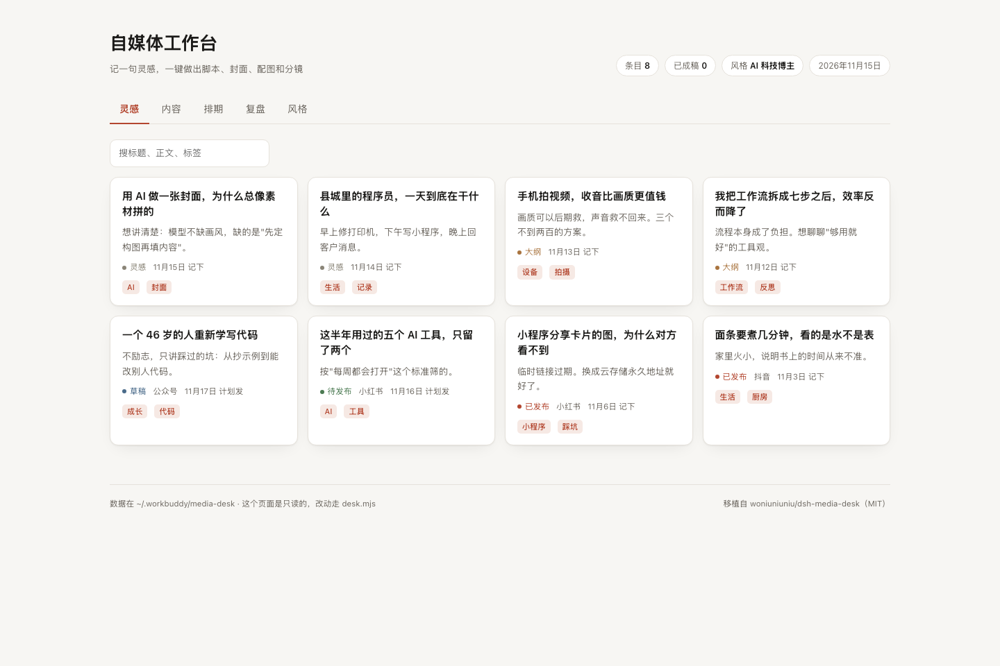
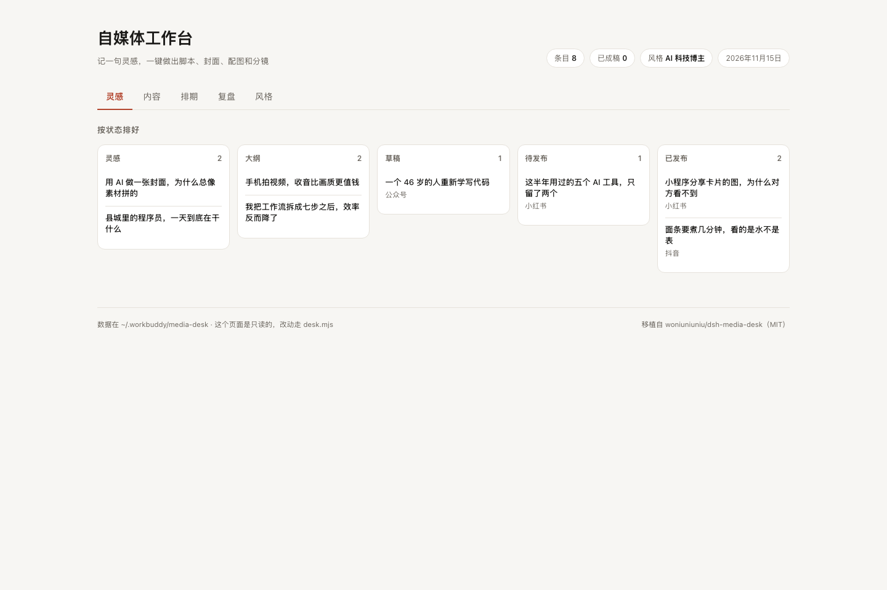
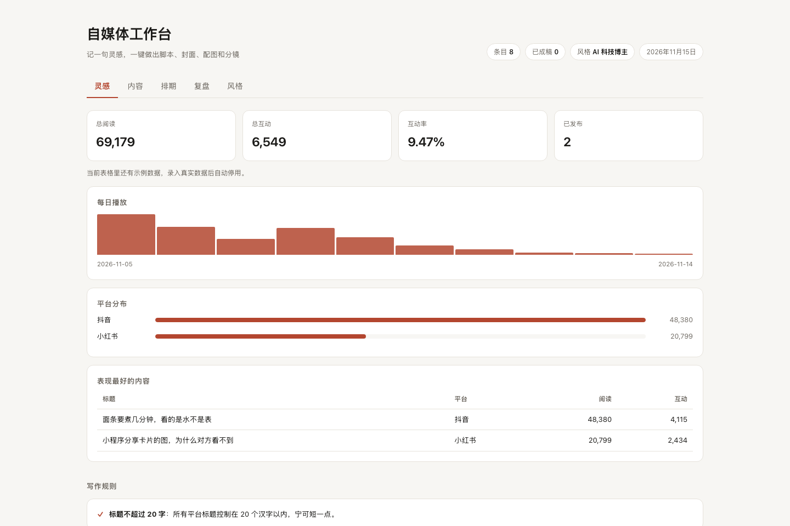

# Media Desk · a WorkBuddy expert package

Jot one line of an idea, get a publishable short-video script, cover copy and storyboard, schedule it, then turn your platform numbers into writing rules that apply to the next draft automatically.

This is a **WorkBuddy port** of [woniuniuniu/dsh-media-desk](https://github.com/woniuniuniu/dsh-media-desk), packaged as a self-contained expert package: the skill ships inside the package, so copying the folder to another machine is enough.



## What it does

- **One line in, full draft out** — brief → voiceover script or article → six-shot storyboard. No interrogation, no "please clarify your goal".
- **Point-and-fix revisions** — "make shot 3 an overhead", "punch up the cover text". It edits that one place and leaves the rest alone.
- **15 style cards** — AI tech, gadget reviews, food hunts, reading notes, business teardowns… or distil a card from your own past posts.
- **Schedule and review** — calendar scheduling, then views / likes / comments / shares / saves with engagement rate, platform split and daily trend.
- **Rules that learn** — patterns found in your own numbers become rules that every later draft obeys.





> Screenshots use the built-in sample data. A fresh install starts empty.

## Install

Requires **Node.js 20+** and the WorkBuddy desktop app.

**One sentence.** Paste this into a fresh WorkBuddy session and it installs itself:

```text
Install the Media Desk as a WorkBuddy skill: clone https://github.com/phs-bitqun/workbuddy-media-desk into ~/.workbuddy/media-desk-src, symlink ~/.workbuddy/skills/media-desk to its skills/media-desk, run `doctor` on scripts/desk.mjs and confirm it prints "内置风格预设 15 个", then remind me to restart WorkBuddy. Don't touch anything already in ~/.workbuddy/media-desk/.
```

That installs the **skill**. For the expert card instead, do it by hand:

```bash
git clone https://github.com/phs-bitqun/workbuddy-media-desk.git
mkdir -p ~/.workbuddy/plugins/marketplaces/my-experts/plugins
cp -R workbuddy-media-desk ~/.workbuddy/plugins/marketplaces/my-experts/plugins/
```

Restart WorkBuddy. An expert card named **自媒体工作台 / Media Desk** shows up under **Experts** in the left sidebar. Click it and start talking.

Windows: copy the `workbuddy-media-desk` folder into `%USERPROFILE%\.workbuddy\plugins\marketplaces\my-experts\plugins\`.

Full walkthrough, FAQ and data migration: **[INSTALL.md](INSTALL.md)** (Chinese).

## Using it

```
Save this idea: AI-made covers always look like a pile of assets
Turn it into a Douyin voiceover script in the AI tech blogger style
Make shot 3 an overhead shot; give the cover text more punch
Log this week's numbers and tell me what pattern I can turn into a rule
```

The interface language is Chinese — the briefs, prompts and style cards are written for a Chinese creator workflow. Commands and the CLI are plain English.

## Where the data lives

`~/.workbuddy/media-desk/state.json` — a local file. No cloud, no account, no telemetry.

- Move machines: copy the whole `~/.workbuddy/media-desk/` directory.
- Relocate: set `WORKBUDDY_MEDIA_DESK_HOME`.
- Don't hand-edit `state.json`; go through the CLI so the undo chain stays intact.

## Verify without opening the app

```bash
DESK="$HOME/.workbuddy/plugins/marketplaces/my-experts/plugins/workbuddy-media-desk/skills/media-desk/scripts/desk.mjs"
node "$DESK" doctor
```

If it prints a data directory and "内置风格预设 15 个", the install is wired up.

## Repo layout

```
workbuddy-media-desk/            # the package — copy this whole folder
├── .codebuddy-plugin/plugin.json
├── agents/workbuddy-media-desk.md
├── avatars/expert.png
├── skills/media-desk/        # skill bundled inside, no external dependency
│   ├── SKILL.md
│   ├── scripts/desk.mjs      # single write path for all state
│   └── references/
└── README.md
docs/                         # screenshots + landing page (GitHub Pages)
```

## Credits & license

- Original project: [woniuniuniu/dsh-media-desk](https://github.com/woniuniuniu/dsh-media-desk), MIT.
- The port replaced the host/client split with one CLI plus a read-only dashboard, swapped image generation for WorkBuddy's built-in tool, and moved storage to `~/.workbuddy/`.
- The 15 style presets, the brief/body/revise/style-distillation prompts and the metrics-to-rules algorithm follow the upstream.
- Released under [MIT](LICENSE).
