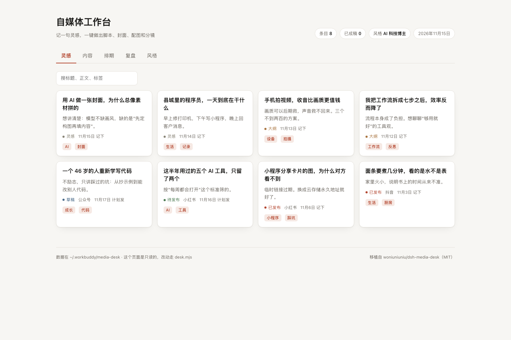
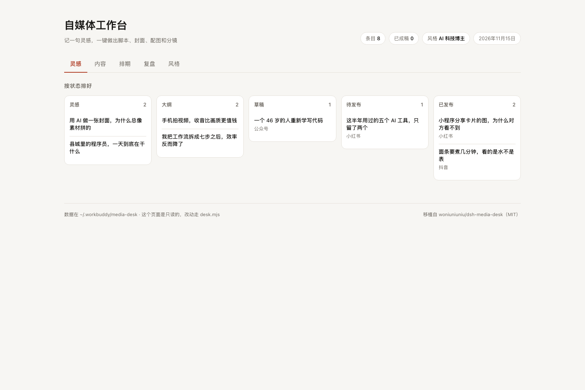
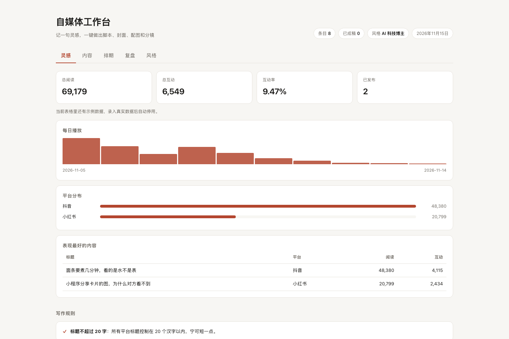

# 自媒体工作台 · Media Desk

一句话记灵感，直接出能发的口播脚本、封面大字和分镜，排好发布时间，再把平台数据读成你自己的写作规则。

这是 [woniuniuniu/dsh-media-desk](https://github.com/woniuniuniu/dsh-media-desk) 的 **WorkBuddy 移植版**（MIT）。上游是 DeepSeek Harness 的侧栏插件，WorkBuddy 没有给第三方开放任意 UI 插槽，所以重构成三个部分：**技能（大脑）+ CLI（唯一写入口）+ 只读看板（五页）**。

一个仓库，两种形态：**专家包**（左侧「专家」里出现一张卡）和**技能**（可直接调用）。技能随包内置，不依赖外部安装。

**[在线介绍页](https://phs-bitqun.github.io/workbuddy-media-desk/)** · **[English](README.en.md)** · **[安装说明](INSTALL.md)**



## 它能干什么

- **一句话成稿**：丢半句想法，出策划案 → 口播脚本 / 文章 → 分镜，中途不反问。
- **点名改稿**：「第 3 镜换俯拍」「封面字更有冲击力」只改那一处，不推翻重写。
- **15 个风格卡**：AI 科技、数码测评、美食探店、读书笔记、商业拆解……也能从自己的稿子里提炼一张。
- **排期 + 复盘**：日历排期，录播放 / 点赞 / 评论 / 转发 / 收藏，出互动率、平台分布、日趋势。
- **规则自我强化**：从数据里提炼规律，确认后变成规则，之后每次成稿自动生效。





> 截图用的是内置示例数据，第一次打开是干净的空工作台。

## 两种装法，选一种

| | 装成什么 | 怎么用 | 适合 |
| --- | --- | --- | --- |
| **A. 专家包** | 左侧「专家」里一张「自媒体工作台」卡 | 点进去直接聊 | 想当成品用、分享给别人 |
| **B. 技能** | 技能列表里的 `media-desk` | 会话里说「记个灵感」自动命中 | 想在自己任意会话里随手调用 |

两种都依赖同一份 `skills/media-desk/`，装一次即可，不必重复。

## 安装

需要 **Node.js 20+**（实测 v22）和 WorkBuddy。

### A · 专家包

```bash
git clone --depth 1 https://github.com/phs-bitqun/workbuddy-media-desk.git ~/workbuddy-media-desk
mkdir -p ~/.workbuddy/plugins/marketplaces/my-experts/plugins
cp -R ~/workbuddy-media-desk ~/.workbuddy/plugins/marketplaces/my-experts/plugins/
```

重启 WorkBuddy，左侧「专家」里会出现「自媒体工作台」。

> PowerShell：`Copy-Item -Recurse "$HOME\workbuddy-media-desk" "$env:USERPROFILE\.workbuddy\plugins\marketplaces\my-experts\plugins\"`

### B · 技能

```bash
git clone --depth 1 https://github.com/phs-bitqun/workbuddy-media-desk ~/.workbuddy/media-desk-src \
  && bash ~/.workbuddy/media-desk-src/install.sh
```

脚本会检查 Node 版本，软链到 `~/.workbuddy/skills/media-desk`，再跑一次自检。重复执行安全：已有源码走 `git pull`。软链的好处是 `git pull` 一次就全线更新。

手工等价写法：

```bash
git clone https://github.com/phs-bitqun/workbuddy-media-desk.git ~/.workbuddy/media-desk-src
ln -sfn ~/.workbuddy/media-desk-src/skills/media-desk ~/.workbuddy/skills/media-desk
```

> `raw.githubusercontent.com` 在国内常被阻断（实测本机 SSL 直接断连），所以不要用 `curl | bash` 式安装，走上面的 git 版本。

详细步骤、常见问题、数据迁移见 **[安装说明](INSTALL.md)**。装不上就 **[提个 issue](https://github.com/phs-bitqun/workbuddy-media-desk/issues/new/choose)**，表单会问系统、Node 版本、卡在哪一步和报错原文。

### 命令行核验

不用打开 WorkBuddy 也能确认装好没有：

```bash
# 技能装法
node ~/.workbuddy/skills/media-desk/scripts/desk.mjs doctor

# 专家包装法
node ~/.workbuddy/plugins/marketplaces/my-experts/plugins/workbuddy-media-desk/skills/media-desk/scripts/desk.mjs doctor
```

打印出数据目录和风格数量，就说明通了。

## 用起来是这样

```
记个灵感：用 AI 做封面总像素材拼的
把这条做成口播脚本，走 AI 科技博主那个风格
第 3 镜换成俯拍，封面字更有冲击力
把这周数据录一下，看看有什么规律可以沉淀成规则
打开工作台
```

## 数据在哪

`~/.workbuddy/media-desk/state.json`，纯本地文件，不上传、没有账号系统。

- 换电脑想带走历史：整个 `~/.workbuddy/media-desk/` 拷过去。
- 想换位置：设环境变量 `WORKBUDDY_MEDIA_DESK_HOME`。
- 别手改 `state.json`，所有改动走 CLI，否则撤销链会断。

## 仓库结构

```
workbuddy-media-desk/             # 整个目录就是一个可分发的包
├── .codebuddy-plugin/plugin.json # 清单：同时声明 skills 和 agents
├── agents/workbuddy-media-desk.md # 专家卡的人格与工作流
├── avatars/expert.png
├── skills/media-desk/            # 技能随包内置
│   ├── SKILL.md                  # 路由 + 六步成稿流程
│   ├── references/               # 提示词全文 / 15 个预设 / 数据模型 / 平台规格
│   └── scripts/
│       ├── desk.mjs              # 状态唯一写入口
│       └── lib/                  # 存储 / 操作 / 复盘 / 看板渲染
├── install.sh                    # 技能装法的一键脚本
├── docs/                         # 截图与介绍页
├── .github/ISSUE_TEMPLATE/       # 安装问题 / 功能建议
├── INSTALL.md · README.en.md · LICENSE
```

零依赖，只要 Node ≥ 20。

## 与上游的差异

| | 上游 dsh-media-desk | 这里 |
| --- | --- | --- |
| **写脚本** | 插件自建会话调 DSH 配置的模型 | WorkBuddy 自身模型 + 移植的提示词 |
| **画封面/配图/分镜** | 自填图片 API Key，或 DSH 订阅生图工具 | WorkBuddy **ImageGen**，零配置 |
| **界面** | DSH 侧栏 React 五页 | `desk.html` 静态只读看板，预览面板打开 |
| **数据** | `~/.dsh/media-desk/` | `~/.workbuddy/media-desk/` |
| **写入** | 界面 → host 路由 | 一律走 `desk.mjs`，禁止手改 JSON |
| **账号导入** | Monid 第三方服务（按次计费） | 未移植，改为手动录 / 粘 CSV |
| **多语言** | 中 / 英双语 | 中文 |

逐字保留：**15 个博主风格预设**、**策划案/正文/改稿/风格提炼提示词**、**复盘→规则的自我强化算法**、**三方合并撤销**、**生图风格后缀**。

## 开发

```bash
cd ~/workbuddy-media-desk
git pull                                        # 更新
node skills/media-desk/scripts/desk.mjs help    # 全部 CLI 命令
WORKBUDDY_MEDIA_DESK_HOME=/tmp/md-test node skills/media-desk/scripts/desk.mjs init --seed
```

改了 `skills/` 要确认软链或重新拷包；改了 `agents/` 要重启 WorkBuddy。

## 致谢与许可

- 原始项目：[woniuniuniu/dsh-media-desk](https://github.com/woniuniuniu/dsh-media-desk)，MIT，作者「蜗牛的科技笔记」。
- 本项目同样以 [MIT](LICENSE) 发布，保留原作者署名。与原作者无关，问题请提到本仓库。
