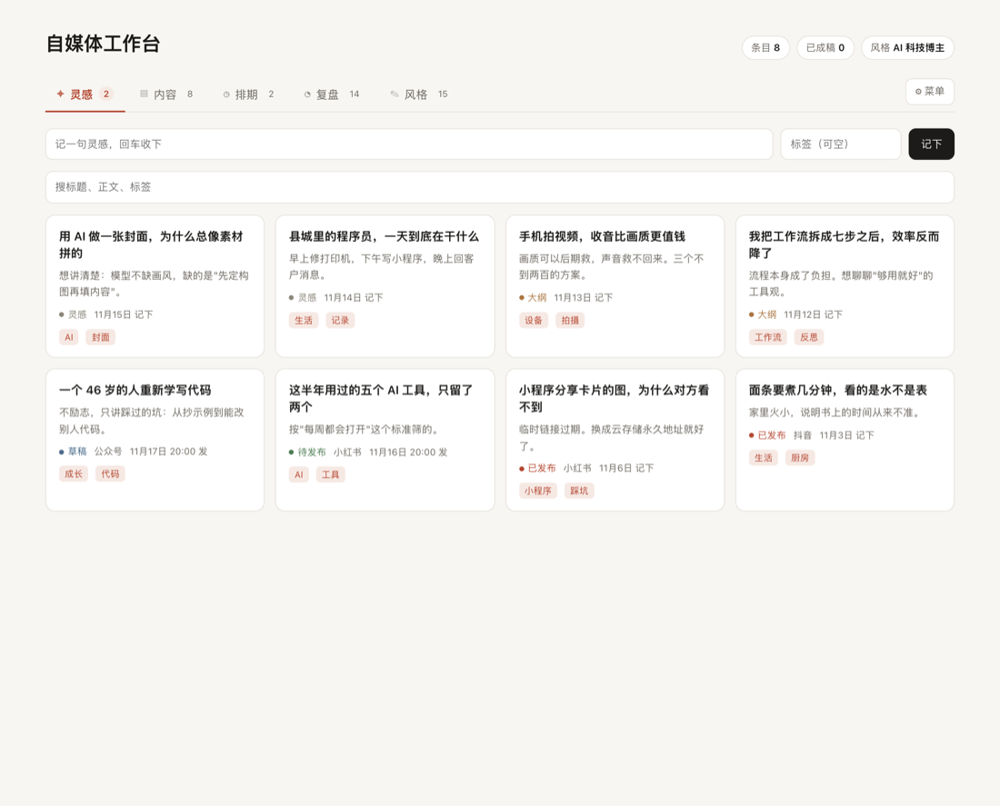
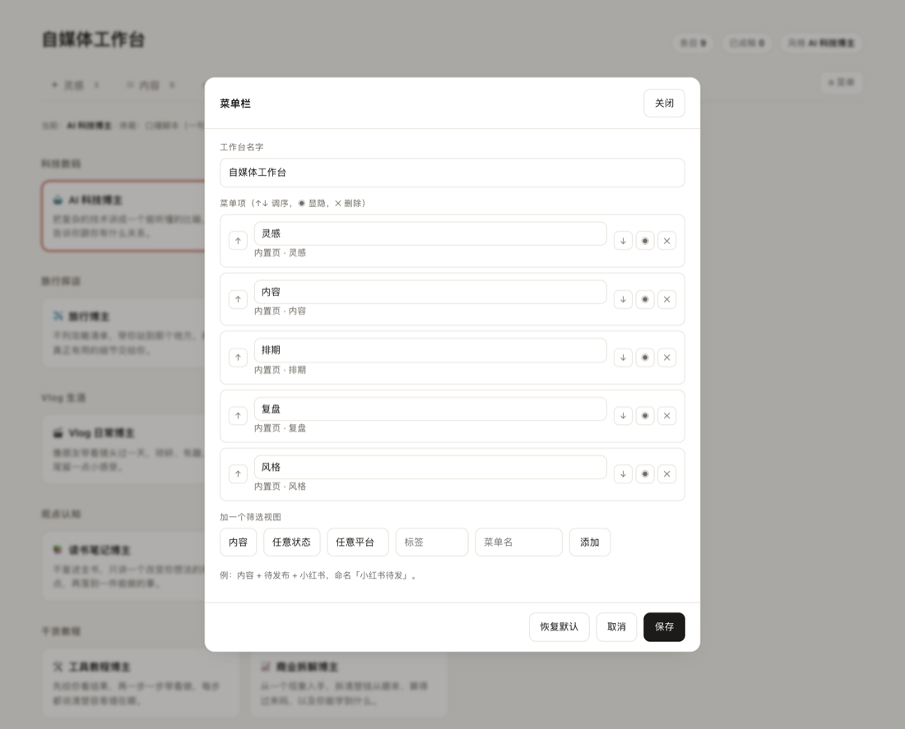

# 自媒体工作台 · Media Desk

一句话记灵感，直接出能发的口播脚本、封面大字和分镜，排好发布时间，再把平台数据读成你自己的写作规则。

这是 [woniuniuniu/dsh-media-desk](https://github.com/woniuniuniu/dsh-media-desk) 的 **WorkBuddy 移植版**（MIT）。上游是 DeepSeek Harness 的侧栏插件；WorkBuddy 没有给第三方开放任意 UI 插槽，所以重构成三部分：**技能（大脑）+ CLI（唯一写入口）+ 本地界面（可读可改）**。

**[在线介绍页](https://phs-bitqun.github.io/workbuddy-media-desk/)** · **[安装说明](INSTALL.md)** · **[English](README.en.md)** · **[提个 issue](https://github.com/phs-bitqun/workbuddy-media-desk/issues/new/choose)**



## 它是什么

- **一句话成稿**：丢半句想法，出策划案 → 口播脚本 / 文章 → 分镜，中途不反问。
- **点名改稿**：「第 3 镜换俯拍」「封面字更有冲击力」只改那一处，不推翻重写。
- **15 个风格卡**：AI 科技、数码测评、美食探店、读书笔记、商业拆解……也能从自己的稿子里提炼一张。
- **排期 + 复盘**：日历排期，录播放 / 点赞 / 评论 / 转发 / 收藏，出互动率、平台分布、日趋势。
- **规则自我强化**：从数据里提炼规律，确认后变成规则，之后每次成稿自动生效。
- **界面菜单可自定义**：页签改名、调序、隐藏，还能加「小红书待发」这种筛选视图。

> 截图用的是示例数据，第一次打开是干净的空工作台。

## 三个入口，一份数据

| 入口 | 长什么样 | 适合 |
| --- | --- | --- |
| **专家卡** | 左侧「专家」里一张「自媒体工作台」卡，点进去直接聊 | 想当成品用、分享给别人 |
| **技能** | 技能列表里的 `media-desk`，任意会话说「记个灵感」自动命中 | 在自己任意会话里随手调用 |
| **本地界面** | `desk serve` → `http://127.0.0.1:4318/`，能看也能改 | 想在界面上记灵感、改稿、排期、传图 |

三者读同一份 `state.json`，装一次即可，可以同时用。

## 界面：看得见，也改得动

```bash
node ~/.workbuddy/skills/media-desk/scripts/desk.mjs serve
# → http://127.0.0.1:4318/     Ctrl+C 停，数据不会丢
```

五页都在：灵感 · 内容 · 排期 · 复盘 · 风格。点卡片开右侧抽屉，改标题、补充、标签、状态、平台、排期；成稿正文能直接编辑；封面和配图能上传；复盘页能录数据、粘 CSV、开关规则、采纳提案；风格页点一张就切过去。

**菜单栏自己配**（右上「⚙ 菜单」）：



- 改工作台名字、给页签改名
- 上下调序、隐藏、删除
- **加筛选视图**——比如「内容 + 待发布 + 小红书」存成「小红书待发」，以后一点只看这些

菜单存在 `state.ui` 里，`desk render` 生成的只读快照也照这份配置排，两边页签不会打架。

**一个边界要说清**：界面负责所有手动活儿，**不负责生成**。写正文、画封面配图分镜需要模型，那在对话里做。抽屉里给了「复制成稿指令」按钮，复制一句话粘到对话就接着干。

服务只绑 `127.0.0.1`，每次启动生成一次性令牌，校验 `Origin`——别的网页调不动它。

不想起服务、只想瞄一眼：`desk render` 生成一份只读 `desk.html`，双击就开。

## 六步成稿

1. **定灵感** — 一句话落地成卡片
2. **写策划案** — 标题、封面大字、事实、小标题、配图与分镜的画面描述（英文），一次定完
3. **写正文** — 口播脚本（一句一行）或文章（自然段），贴着风格卡和生效规则写
4. **画图** — 封面 + 配图 + 白线稿分镜，逐张取提示词交给 ImageGen，画完登记回来
5. **交付** — 导出文件夹：脚本、分镜脚本、封面、配图、分镜图
6. **收尾** — 刷新看板给你看

改稿不走重做，走 `revise`：只改要改的字段，`edits` 做局部替换，要换画面才给新 `prompt`。

## 安装

需要 **Node.js 20+**（实测 v22）和 WorkBuddy 桌面版。

### 0 · 一句话（推荐）

把下面这段整段粘给 WorkBuddy 的新会话，它自己克隆、挂载、自检：

```text
帮我把自媒体工作台装成 WorkBuddy 技能：从 https://github.com/phs-bitqun/workbuddy-media-desk 克隆到 ~/.workbuddy/media-desk-src，把 ~/.workbuddy/skills/media-desk 软链接到它的 skills/media-desk，跑一次 scripts/desk.mjs 的 doctor 确认打印出「内置风格预设 15 个」，装完提醒我重启 WorkBuddy；不要动 ~/.workbuddy/media-desk/ 里已有的数据。
```

### A · 专家包

```bash
git clone --depth 1 https://github.com/phs-bitqun/workbuddy-media-desk.git ~/workbuddy-media-desk
mkdir -p ~/.workbuddy/plugins/marketplaces/my-experts/plugins
cp -R ~/workbuddy-media-desk ~/.workbuddy/plugins/marketplaces/my-experts/plugins/
```

重启 WorkBuddy，左侧「专家」里会出现「自媒体工作台」。

> PowerShell：`Copy-Item -Recurse "$HOME\workbuddy-media-desk" "$env:USERPROFILE\.workbuddy\plugins\marketplaces\my-experts\plugins\"`

### B · 技能

```bash
git clone --depth 1 https://github.com/phs-bitqun/workbuddy-media-desk ~/.workbuddy/media-desk-src \
  && bash ~/.workbuddy/media-desk-src/install.sh
```

脚本会检查 Node 版本、软链到 `~/.workbuddy/skills/media-desk`、跑一次自检。重复执行安全：已有源码走 `git pull`。

> `raw.githubusercontent.com` 在国内常被阻断（实测本机 SSL 直接断连），所以别用 `curl | bash` 式安装，走上面的 git 版本。

详细步骤、常见问题、数据迁移见 **[安装说明](INSTALL.md)**。

### 核验

```bash
node ~/.workbuddy/skills/media-desk/scripts/desk.mjs doctor
```

打印出数据目录和「内置风格预设 15 个」，就说明通了。

## 常用命令

```bash
DESK=~/.workbuddy/skills/media-desk/scripts/desk.mjs

node $DESK serve                      # 起交互界面（可改数据）
node $DESK render                     # 生成只读 desk.html
node $DESK add --title "…"            # 记灵感
node $DESK plan <id> --file p.json    # 落盘策划案
node $DESK article <id> --file a.md   # 写正文
node $DESK prompt <id> cover          # 取生图提示词，交给 ImageGen
node $DESK asset <id> cover --file x.jpg  # 登记画好的图
node $DESK revise <id> --file r.json  # 改稿
node $DESK schedule <id> --at "2026-11-20 20:00"
node $DESK metric import --file d.csv # 录数据
node $DESK insights                   # 复盘
node $DESK export <id>                # 导出文件夹
node $DESK undo                       # 撤销上一步
node $DESK help                       # 全部命令
```

## 用起来是这样

```
记个灵感：用 AI 做封面总像素材拼的
把这条做成口播脚本，走 AI 科技博主那个风格
第 3 镜换成俯拍，封面字更有冲击力
把这周数据录一下，看看有什么规律可以沉淀成规则
打开工作台
```

## 数据在哪

`~/.workbuddy/media-desk/state.json`，纯本地文件，不上传、没有账号、没有埋点。

- 换电脑想带走历史：整个 `~/.workbuddy/media-desk/` 拷过去。
- 想换位置：设环境变量 `WORKBUDDY_MEDIA_DESK_HOME`。
- 别手改 `state.json`，所有改动走 CLI 或界面，否则撤销链会断。

## 仓库结构

```
workbuddy-media-desk/             # 整个目录就是一个可分发的包
├── .codebuddy-plugin/plugin.json # 清单：同时声明 skills 和 agents
├── agents/workbuddy-media-desk.md # 专家卡的人格与工作流
├── avatars/expert.png
├── skills/media-desk/            # 技能随包内置
│   ├── SKILL.md                  # 路由 + 六步成稿流程
│   ├── references/               # 提示词全文 / 15 个预设 / 数据模型 / 平台规格
│   └── scripts/
│       ├── desk.mjs              # 状态唯一写入口（含 serve / render）
│       ├── app/                  # 交互界面：index.html + app.css + app.js
│       └── lib/                  # 存储 / 操作 / 复盘 / 渲染 / 服务 / 导出
├── install.sh                    # 技能装法的一键脚本
├── tests/                        # node --test，47 项，零依赖
├── docs/                         # 截图与介绍页
├── .github/ISSUE_TEMPLATE/       # 安装问题 / 功能建议
├── INSTALL.md · README.en.md · LICENSE
```

零依赖，只要 Node ≥ 20。

## 与上游的差异

| | 上游 dsh-media-desk | 这里 |
| --- | --- | --- |
| **写脚本** | 插件自建会话调 DSH 配置的模型 | WorkBuddy 自身模型 + 移植的提示词 |
| **画封面/配图/分镜** | 自填图片 API Key，或 DSH 订阅生图工具 | WorkBuddy **ImageGen**，零配置 |
| **界面** | DSH 侧栏 React 五页 | `desk serve` 本地交互界面 + `desk render` 只读快照 |
| **数据** | `~/.dsh/media-desk/` | `~/.workbuddy/media-desk/` |
| **写入** | 界面 → host 路由 | 一律走 `desk.mjs`，禁止手改 JSON |
| **账号导入** | Monid 第三方服务（按次计费） | 未移植，改为手动录 / 粘 CSV |
| **多语言** | 中 / 英双语 | 中文 |

逐字保留：**15 个博主风格预设**、**策划案/正文/改稿/风格提炼提示词**、**复盘→规则的自我强化算法**、**三方合并撤销**、**生图风格后缀**。

## 已知限制

- **不能直接发布**。各平台没有统一接口，做完只能导出文件夹，你自己发。
- **界面里不生成内容**。写稿画图要模型，回对话说一句。
- **界面是本地服务**，不是侧栏内嵌。关掉终端就停，不会后台常驻（想常驻可以配 launchd）。
- **账号导入没做**。复盘靠手动录或粘 CSV；CSV 加一列 `externalId` 才是「累计数据」，否则和手动记录会重复计。
- **只有中文**。上游的中英双语没移植。

## 可靠性

这几条是踩过坑之后加的，写在这里免得再踩：

- **多进程同时写不会丢数据**。CLI、界面、两个终端共用一份 `state.json`，写入靠数据目录里的 `.lock` 互斥，进锁后强制重读再写。实测 20 个进程并发写，20 条全在。
- **不会删你的目录**。`install.sh` 发现目标已存在但不是 Git 仓库（或 origin 不匹配）时直接停下，只告诉你怎么办，不动手。
- **同名标题不会互相覆盖**。两篇同名稿子导出到两个目录；同一篇重导回原目录，并明确提示「已覆盖更新」。
- **数据文件权限是 0600、目录 0700**，不看系统 umask。
- **CSV 坏行会报出来**，带行号和原因，不会静默把非法日期改今天、把乱码数字记成 0。

## 测试

```bash
node --test tests/*.test.mjs
```

47 项，零依赖，用 Node 内置 runner。覆盖：跨进程并发写、锁接管、文件权限、安装脚本的拒绝路径、CSV 解析（BOM/引号/坏行）、复盘平台分组、累计数据去重、导出目录冲突、HTTP 接口鉴权与路径穿越。

## 反馈

装不上、发现 bug、想要功能，都走同一个入口：

**https://github.com/phs-bitqun/workbuddy-media-desk/issues/new/choose**

- **安装 / 运行问题** — 表单会问系统、Node 版本、卡在哪一步、报错原文。这几项填全，基本一轮定位。
- **功能建议** — 说清你想解决什么问题，而不是只给一个方案。

## 开发

```bash
cd ~/workbuddy-media-desk
git pull                                        # 更新
node skills/media-desk/scripts/desk.mjs help    # 全部 CLI 命令
WORKBUDDY_MEDIA_DESK_HOME=/tmp/md-test node skills/media-desk/scripts/desk.mjs init --seed
```

改了 `skills/` 要确认软链或重新拷包；改了 `agents/` 要重启 WorkBuddy。

## 致谢与许可

- 原始项目：[woniuniuniu/dsh-media-desk](https://github.com/woniuniuniu/dsh-media-desk)，MIT，作者「蜗牛的科技笔记」。
- 本项目同样以 [MIT](LICENSE) 发布，保留原作者署名。与原作者无关，问题请提到本仓库。
